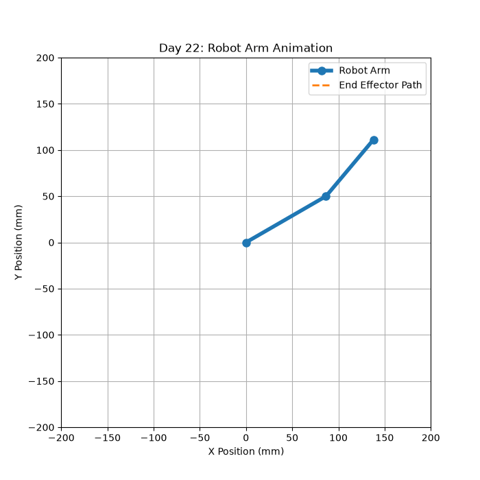

# Robot Control System | ROS 2 & Panda Manipulation

A 45-day robotics learning and simulation project covering robot
kinematics, trajectory planning, ROS 2 communication, motion planning,
and robotic grasping.

## Project Overview

This project explores the fundamentals of robotic arm control and
simulation, progressing from Python-based kinematics to a 7-DOF
Franka Emika Panda robotic arm in Gazebo and MoveIt 2.

The final demonstration involved manually specifying grasp poses
in RViz, planning and executing arm trajectories using MoveIt 2,
and successfully grasping and lifting a cube in Gazebo.

## Technology Stack

- Python 3
- NumPy
- ROS 2 Jazzy
- Ubuntu 24.04 / WSL2
- Gazebo Harmonic
- MoveIt 2
- RViz2
- ros2_control
- URDF

## Implemented Features

- Forward and inverse kinematics
- Jacobian-based robot velocity control
- Trajectory generation and interpolation
- Robot joint-state publishing and monitoring
- ROS 2 topics, services, and actions
- Robot motion planning with MoveIt 2
- Panda robotic arm simulation in Gazebo
- Two-finger gripper position control
- Cube grasping and lifting demonstration

## Repository Structure

- `ros2/robot_state_demo/` — ROS 2 communication and robot states
- `ros2/robot_interfaces/` — Custom ROS 2 interfaces
- `ros2/day40_arm_moveit_config/` — MoveIt 2 configuration
- `ros2/day42_panda_obstacles/` — Obstacle management
- `ros2/day43_panda_gazebo/` — Gazebo simulation code
- `ros2/day44_panda_gripper/` — Gripper and simulation configuration
- `ros2/day45_panda_auto/` — Experimental grasp planning scripts

## Final Demonstration

The Panda robot successfully performed the following steps:

1. Planned a collision-free approach trajectory in RViz.
2. Executed the motion in Gazebo through ROS 2 controllers.
3. Positioned the gripper around a simulated cube.
4. Closed the gripper to grasp the cube.
5. Lifted the cube from the ground.

The final grasping demonstration was performed with manually selected
target poses. Fully autonomous pick-and-place is not claimed.

## Environment

- Ubuntu 24.04 on WSL2
- ROS 2 Jazzy
- Gazebo Harmonic
- MoveIt 2

## Author

Tong Xu

GitHub: https://github.com/TongXu06


---

# Earlier Python Robot Control Project


# Robot Control System

A Python-based robot joint control simulation project.

## Features

- Control robot joint angles
- Check joint safety limits
- Display robot status
- Record movement history
- Reset robot positions

## Technologies

- Python
- Object-Oriented Programming (OOP)
- Git and GitHub

## How to Run

```bash
python main.py
```

## Project Goal

This project is part of my learning journey in robotics and embodied AI.

Future improvements:
- Robot motion visualization
- Joint trajectory planning
- Robot simulation


## Robot Arm Animation

This project demonstrates quintic trajectory planning,
forward kinematics, and 2D robot arm visualization.

